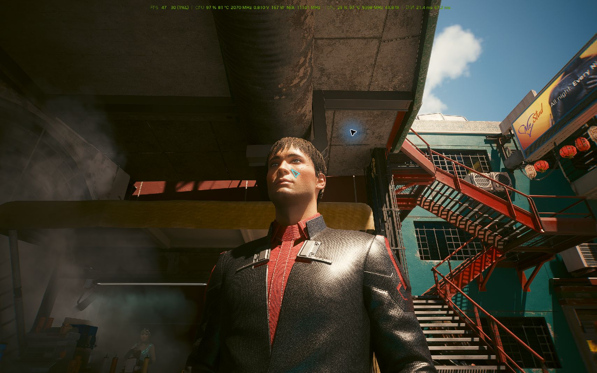
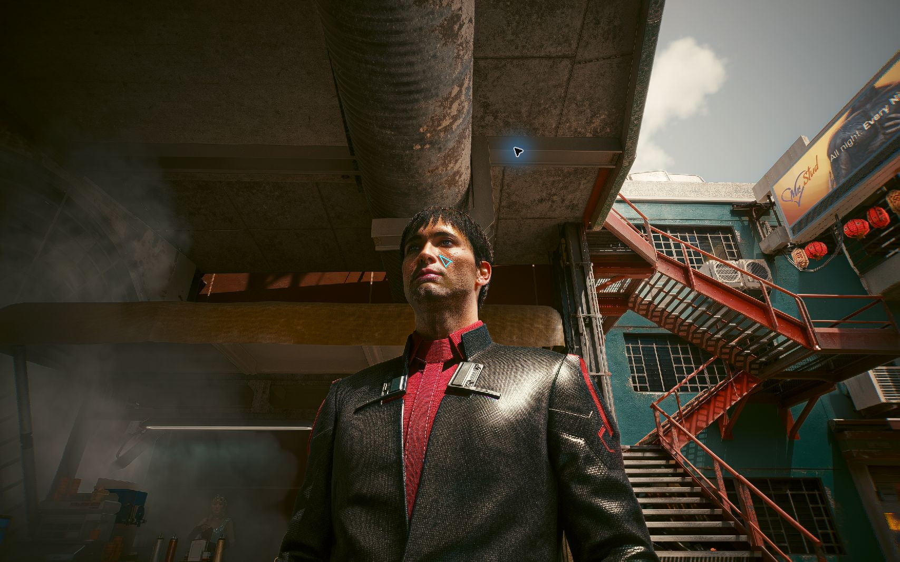

# DLSS Neural Rendering: community experiments and evidence

[简体中文](README.zh-CN.md) · [Findings](docs/findings.md) · [Read-only tools](docs/usage.md) · [Contributing](CONTRIBUTING.md)

[](https://github.com/yirancheng12-design/dlss5guidens/actions/workflows/validate.yml)
[](LICENSE)

What did a community Neural Rendering setup actually do in Cyberpunk 2077 and Wuthering Waves? This archive keeps configuration records, crash investigations, screenshots and limited runtime observations so readers can inspect the evidence.

**Start here:** this is a historical experiment archive with an offline Python inspector. The bundled Windows controllers are installation-specific historical scripts, not a portable mod installer. No game binaries or NR runtime DLLs are distributed here. Passing archive checks does not validate game compatibility.

## One-click installation (Windows)

With Python 3.11+ installed, extract the whole repository and double-click [Install.cmd](Install.cmd). It creates `.venv` and verifies the bundled archive/tools without package downloads. Then double-click [Run.cmd](Run.cmd) to display the recorded-data summary. It does not install drivers, game mods or runtime DLLs. See [installation details and recovery](INSTALL.md).

### Requirements before you click

| Requirement | What you need |
| --- | --- |
| Python | Python 3.11+ with the standard `venv` module; enable `py` or `python` on PATH. Python is not automatically installed |
| Files and permissions | Extract/clone the complete repository into a writable folder; run outside the ZIP. Administrator access is not required |
| Platform | `.cmd` entry points require Windows. Linux/macOS users run `python3 tools/install.py` for the core tools |
| Network and dependencies | After downloading the complete repository and installing Python, setup uses only the standard library; no pip packages or internet connection are required |
| Hardware and scope | No NVIDIA GPU, installed game or administrator access is required. This installs an analysis/archive environment, not a GPU driver, tuning profile or game Mod |

Successful setup ends with `Installation and verification passed` and `.setup-state.json` containing `ok: true`. If it fails, read `.setup.log`, fix the cause and rerun the installer; do not treat a created `.venv` alone as success.


## What the evidence supports

| Case | Recorded observation | Limit |
| --- | --- | --- |
| Cyberpunk 2077, Oct 16 | Repeated crashes led to removal; later 10-minute trials recorded no new crashes with selected profiles | Both failure and later retest records matter |
| Cyberpunk 2077 controller v2, Oct 17 | 19.4 minutes: 67% scale, one pass, native 2× frame generation, zero new crash reports | Average FPS and 1% low were not measured in this trial |
| Cyberpunk 2077 photo comparison, Oct 17 | OFF and 100% scale / three-pass captures, with runtime observations recorded in the notes | Different frames, resized JPEGs, no long gameplay test |
| Wuthering Waves | Audit, installation and configuration-change records | The 85% profile explicitly says `RuntimeTest: NOT_RUN` |

Read the [English findings and source links](docs/findings.md). Here **NR means Neural Rendering**, as used by the archived `nvngx_dlssnr.dll` and `[DlssNr]` settings. It does not mean NVIDIA Reflex. NVIDIA describes DLSS 5 as a neural rendering feature; see the [official technology explanation](https://www.nvidia.com/en-us/geforce/news/dlss-5-3d-guided-neural-rendering/). These community tests do not establish official game support.

## Inspect the archive in one minute

Requires Python 3.11+. No packages, GPU, game, administrator access or network are needed. Run from the repository root:

```console
python tools/archive.py verify
python tools/archive.py summary
python -m unittest discover -s tests -v
```

`verify` checks the original evidence inventory, SHA-256 hashes, JSON syntax, evidence references and local Markdown targets. `summary` reads source JSON and prints observations with their limitations. Both commands read repository files only. Add `--json` for machine-readable output. See [expected output and validation limits](docs/validation.md).

## Visual comparison

| Recorded NR OFF capture | Recorded NR ON: 100% scale, three passes |
| --- | --- |
|  |  |

The [capture notes](01_Cyberpunk2077/Cyberpunk2077_NR100_3Pass_COMPARE_20261017/README.txt) describe timing and restoration. Captures are 1707×1067 JPEGs from a 2560×1600 render; smoke and temporal effects can differ. They are not a matched-frame benchmark or a claim of increased FPS.

## Repository map

| Location | Contents |
| --- | --- |
| [01_Cyberpunk2077](01_Cyberpunk2077/README.md) | Canonical game entry: reports, JSON, captures and historical controllers |
| [02_WutheringWaves](02_WutheringWaves/README.md) | Canonical audit and configuration records |
| [Archive map](docs/archive-map.md) | Common runtime/static audits, duplicate directories and unrelated historical material |
| [tools](tools/archive.py) | Portable offline inspector |
| [evidence](evidence/README.md) | Original-file inventory and curated source references |

Numbered and unnumbered historical directories are preserved. Some reports differ; use the numbered game entries for new links. Windows paths identify the author's machine, not setup instructions. Some identifiers remain: this archive is **not fully anonymized**.

## Contribute a useful result

Open an [evidence report](https://github.com/yirancheng12-design/dlss5guidens/issues/new?template=evidence.yml) with exact versions, changed settings, observation duration, runtime evidence, failures and unknowns. Follow [CONTRIBUTING.md](CONTRIBUTING.md) for reproducible comparisons. A star helps readers find the archive; independently repeatable evidence is the most useful contribution.

Original project code and documentation use [MIT](LICENSE). Third-party captures, vendor names, logs and referenced components retain their respective rights; see [provenance](docs/provenance.md). This project is independent of NVIDIA and game publishers.
